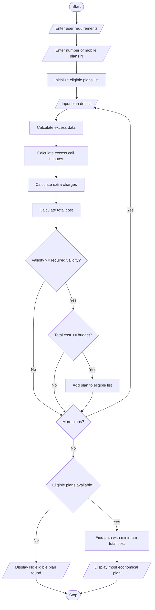

# Multi-Plan Telecommunications Cost Optimization Using Python

## 1. Problem Statement

The Multi-Plan Telecommunications Cost Optimization problem aims to identify the most economical mobile recharge plan based on the user's monthly usage, validity requirements, and budget constraints.

Different mobile plans offer different benefits, such as data limits, call minutes, validity periods, and prices. If the user's usage exceeds the plan limits, additional charges (excess charges) are applied.

The objective is to:

- Accept the user's data usage, call usage, required validity, and budget.
- Compare multiple mobile plans.
- Calculate excess data and call charges for each plan.
- Calculate the total cost of each plan.
- Eliminate plans that do not satisfy the budget and validity constraints.
- Identify the most economical eligible plan.

## 2. Algorithm

1. Start.
2. Read the user's requirements:
   - Required data usage (GB).
   - Required call minutes.
   - Required validity (days).
   - Maximum budget.
3. Read the number of available mobile plans.
4. For each plan, input:
   - Plan name.
   - Plan price.
   - Data limit.
   - Call minutes limit.
   - Validity days.
   - Extra data charge per GB.
   - Extra call charge per minute.
5. Calculate excess data:

\\[ ExcessData = \max(0, RequiredData-PlanData) \\]

6\. Calculate excess call minutes:

\\[ ExcessCalls = \max(0, RequiredCalls-PlanCalls) \\]

7\. Calculate additional charges:

\\[ ExtraCost = (ExcessData \times DataRate) \\]

\\[ + (ExcessCalls \times CallRate) \\]

8\. Calculate total cost:

\\[ TotalCost = PlanPrice + ExtraCost \\]

9. Check whether the plan satisfies the validity and budget constraints.
10. If eligible, compare its total cost with other eligible plans.
11. Select the plan with the minimum total cost.
12. If no plan is eligible, display "No eligible plan found".
13. Stop.


## 5. Sample Input

Assume the following input:

```
Enter required data usage (GB): 3
Enter required call minutes: 500
Enter required validity (days): 28
Enter maximum budget (Rs): 300

Enter number of mobile plans: 3

Enter details of Plan 1
Plan name: Basic
Plan price (Rs): 149
Data limit (GB): 2
Call minutes limit: 300
Validity (days): 28
Extra data charge per GB (Rs): 20
Extra call charge per minute (Rs): 0.5

Enter details of Plan 2
Plan name: Standard
Plan price (Rs): 199
Data limit (GB): 3
Call minutes limit: 500
Validity (days): 28
Extra data charge per GB (Rs): 20
Extra call charge per minute (Rs): 0.5

Enter details of Plan 3
Plan name: Premium
Plan price (Rs): 249
Data limit (GB): 5
Call minutes limit: 1000
Validity (days): 56
Extra data charge per GB (Rs): 20
Extra call charge per minute (Rs): 0.5
```

## 6. Sample Output

```
Plan: Basic
Excess Data: 1.0 GB
Excess Calls: 200 minutes
Extra Charges: 120.0
Total Cost: Rs. 269.0

Plan: Standard
Excess Data: 0 GB
Excess Calls: 0 minutes
Extra Charges: 0.0
Total Cost: Rs. 199.0

Plan: Premium
Excess Data: 0 GB
Excess Calls: 0 minutes
Extra Charges: 0.0
Total Cost: Rs. 249.0

----- OPTIMIZATION RESULT -----

Most Economical Eligible Plan: Standard
Minimum Total Cost: Rs. 199.0
```

## 7. Mermaid Flowchart Code



## 8. Expected Result

The program successfully compares different telecommunications plans based on data usage, call minutes, validity, and budget.

Conclusion: The system identifies the Standard plan as the most economical eligible option because it satisfies all the user's requirements within the specified budget, with the minimum total cost.
