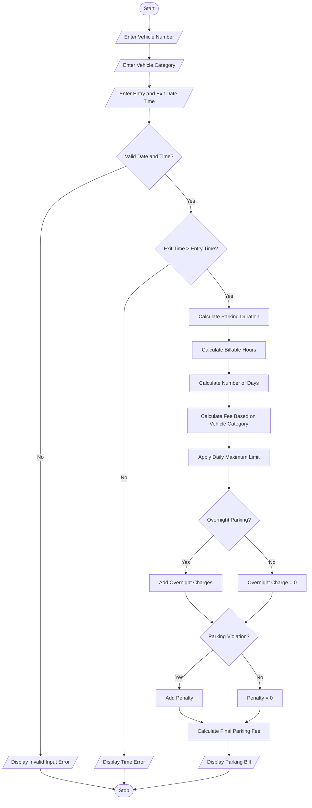

# Smart Parking Fee Management System – Python Project

## 1. Problem Statement

The Smart Parking Fee Management System is designed to calculate parking charges based on vehicle entry time, exit time, vehicle category, overnight parking, daily parking limits, and penalty conditions.

The system accepts the vehicle number, vehicle category, entry date and time, and exit date and time. It validates the entered time values and calculates the total parking duration.

Different vehicle categories have different hourly parking rates. Additional charges may apply for overnight parking or invalid parking conditions. The system also applies a maximum daily parking limit to prevent excessive charges.

Finally, the system displays the total parking duration, parking fee, penalty amount, and final amount payable.

Objectives:

- Validate entry and exit date and time.
- Calculate total parking duration.
- Apply different rates for different vehicle categories.
- Calculate overnight parking charges.
- Apply daily maximum parking limits.
- Add penalties for violations.
- Display the final parking bill.

## 2. Algorithm

1. Start the program.
2. Define parking rates for different vehicle categories:
   - Two-wheeler: ₹10 per hour.
   - Car: ₹20 per hour.
   - Bus: ₹40 per hour.
3. Define the maximum daily parking limit for each vehicle category.
4. Accept the vehicle number.
5. Accept the vehicle category.
6. Accept entry date and time.
7. Accept exit date and time.
8. Validate the date and time inputs.
9. Check whether the exit time is later than the entry time.
10. Calculate the total parking duration in minutes.
11. Convert the duration into billable hours using ceiling calculation.
12. Calculate the number of parking days.
13. Calculate the parking fee according to the vehicle category.
14. Apply the daily maximum parking limit.
15. Check for overnight parking and calculate additional charges if applicable.
16. Check for penalty conditions and add penalty charges if applicable.
17. Calculate the final parking amount.
18. Display the parking bill.
19. Stop the program.


## 5. Sample Input

```
===== SMART PARKING FEE MANAGEMENT =====

Enter vehicle number: AP39AB1234

Vehicle Categories:
1. Two-wheeler
2. Car
3. Bus

Enter vehicle category: car

Enter entry date and time (YYYY-MM-DD HH:MM):
2026-11-01 20:00

Enter exit date and time (YYYY-MM-DD HH:MM):
2026-11-02 08:00

Is there any parking violation? (yes/no):
no
```

## 6. Sample Output

```
========== PARKING BILL ==========

Vehicle Number : AP39AB1234
Vehicle Category: Car

Entry Time     : 2026-11-01 20:00:00
Exit Time      : 2026-11-02 08:00:00

Duration       : 12.0 hours
Billable Hours : 12

Parking Fee    : Rs. 200
Overnight Fee  : Rs. 50
Penalty        : Rs. 0

---------------------------------
TOTAL AMOUNT   : Rs. 250
=================================
```

Calculation:

- Parking duration = 12 hours.
- Car hourly rate = ₹20.
- Hourly fee = 12 × 20 = ₹240.
- Daily maximum = ₹200.
- Parking fee = Minimum (₹240, ₹200) = ₹200.
- Overnight fee = ₹50.
- Penalty = ₹0.
- Final amount = ₹200 + ₹50 = ₹250.

## 7. Mermaid Flowchart Code



## 8. Expected Result

The Smart Parking Fee Management System successfully calculates parking charges based on vehicle category, parking duration, overnight parking, daily maximum limits, and penalty conditions.

It also validates date and time inputs to prevent incorrect parking fee calculations.

Conclusion: This project provides an efficient and user-friendly parking fee calculation system that reduces manual calculation errors and helps automate parking management.

